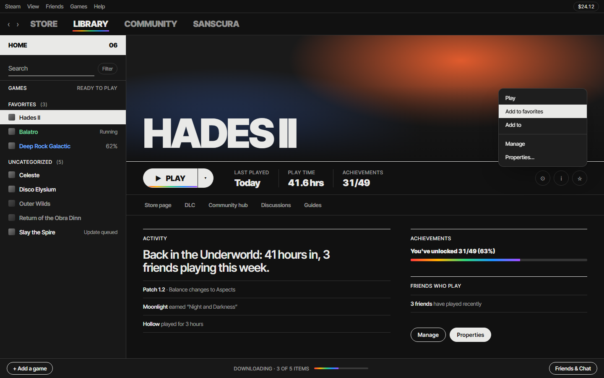
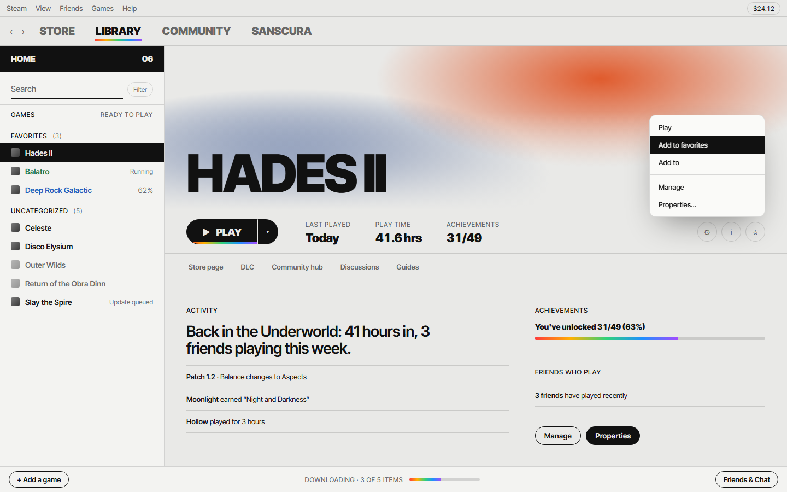

<h1 align="center">Steam Glass</h1>

<p align="center"><b>Steam set like a printed page: ink on paper, heavy type and nothing you don't need.</b></p>

<p align="center">
  <a href="https://github.com/EY4O/Steam-Glass-Theme/blob/main/LICENSE"></a>
  <a href="https://github.com/EY4O/Steam-Glass-Theme/commits/main"></a>
  <a href="https://ko-fi.com/looneth"></a>
</p>

Steam Glass is a [Millennium](https://steambrew.app) theme for the Steam desktop client, built from the look of [Glass Dashboard](https://github.com/EY4O/glass-dashboard). It restyles the library, the title bar and nav, menus, dialogs and settings, the friends list and chat, and the store and community pages. Everything uses heavy uppercase Inter Tight, hairline rules, pill-shaped controls and one rainbow prism accent, in a dark **Ink** mode or a light **Paper** mode.



> **⚠ Needs Millennium.** Steam Glass is a Millennium theme, so install [Millennium](https://steambrew.app) first.

> **🚧 Early release.** 1.0.0 has been checked on a preview page built from Steam's own class names, but not yet across the whole client. Some views may still show Steam's colours, especially in Paper. [Issues](https://github.com/EY4O/Steam-Glass-Theme/issues) with a screenshot help a lot.

---

## ✨ Key Features

- 🖋️ **Ink and Paper** — a dark sheet and a light one, switched from the theme's settings.
- 🧾 **Ink row wipe** — library games, friends, settings pages and store rows fill with ink from the bottom on hover, and the text turns paper.
- 🔠 **Heavy uppercase type** — STORE / LIBRARY / COMMUNITY, game titles and play buttons in Inter Tight 900; labels are small letter-spaced caps.
- 💊 **Pill controls** — buttons, tabs, dropdowns, filters and the Play button are hairline pills that fill with ink when you use them.
- 🌈 **One prism accent** — the open tab, the Play button edge and progress bars get a thin rainbow; switch it off for pure monochrome.
- 📏 **Ruled stats** — last played, play time and achievements sit in a ruled row with big numbers, like the dashboard's fact row.
- 🛒 **Store and community too** — buttons, prices, discounts, search results, tags and menus follow the same rules.
- 🧱 **Built to last through updates** — styled on the readable class names Millennium adds, not the hashed names that change with each Steam build.

## 📸 Screenshots

| | |
|---|---|
|  **Ink** — paper type on #111, the selected game and the open tab underlined in prism |  **Paper** — the same sheet in ink on warm grey; Steam's leftover colours go flat |

<sub>Screenshots are of the preview page in <code>tools/preview</code>, which uses Steam's class names with sample games. They are not captures of the Steam client itself.</sub>

---

## 📦 Installation

### Option 1: **Download the ZIP** (Recommended)

1. Download [Steam-Glass-Theme-main.zip](https://github.com/EY4O/Steam-Glass-Theme/archive/refs/heads/main.zip).
2. Extract it into your Millennium themes folder, so you end up with `...\Steam\millennium\themes\Steam-Glass-Theme\skin.json`.
3. Restart Steam.

### Option 2: **Manual Installation**

```bash
cd "C:/Program Files (x86)/Steam/millennium/themes"
git clone https://github.com/EY4O/Steam-Glass-Theme.git
```

Pull to update:

```bash
git -C "C:/Program Files (x86)/Steam/millennium/themes/Steam-Glass-Theme" pull
```

<details>
<summary><b>Where the themes folder is</b></summary>

- **Windows:** `C:\Program Files (x86)\Steam\millennium\themes\` for a default Steam install. Use your own Steam folder if you installed it elsewhere.
- **Linux and macOS:** `millennium/themes` inside your Steam folder.
- **Older Millennium builds** (before March 2026) used `Steam\steamui\skins\`. Current builds move anything left there into `millennium\themes` when Steam starts.

The folder needs `skin.json` directly inside it, not one level deeper.
</details>

## 🚀 Getting Started

1. Open Steam and go to **Millennium → Themes**.
2. Pick **Steam Glass** and let Steam reload.
3. Open the theme's settings (the gear next to it) and go to the **Style** tab.
4. Set **Mode** to **Ink** or **Paper**. Steam reloads its UI when you change it.
5. Turn **Prism accent** off if you want pure black and white.

---

## 📖 How It Works

<details>
<summary><b>🪟 Which file styles what</b></summary>

Millennium matches each Steam window and loads the matching stylesheet:

| File | Styles |
|---|---|
| `libraryroot.custom.css` | The main window (library, title bar, nav, bottom bar, downloads) plus menus, popups and modals |
| `friends.custom.css` | The friends list and chat windows |
| `webkit.css` | Store and community pages |
| `shared/client.css` | Controls every client window shares: buttons, inputs, dropdowns, context menus, dialogs, settings, scrollbars |
| `shared/tokens.css` | Fonts, the prism, easing and fallback colours |
| `modes/ink.css`, `modes/paper.css` | The two colour sets, loaded by the **Mode** setting |
| `options/no-prism.css` | Loaded when **Prism accent** is off |

Big Picture mode is left as Steam draws it.
</details>

<details>
<summary><b>🎨 Ink, Paper and the prism</b></summary>

Both modes define the same colour tokens (`--gs-bg`, `--gs-fg`, `--gs-mute`, `--gs-line` and a few status colours), and every rule in the theme uses them. That's why one setting can flip the whole client.

Steam hard-codes light text and dark panels in hundreds of places. Light text on a dark Steam panel still reads fine in Ink, so Ink leaves those alone. In Paper it wouldn't, so Paper flattens them: Steam's own panel colours become transparent and its text takes the ink colour. Game art and images are untouched. Anything the theme styles itself, such as hover wipes, selected rows and pills, is more specific and keeps its colours. The trade-off is that a few things Steam marks only with a colour, like some badges, can lose it in Paper.

With the prism off, every prism use falls back to plain ink.
</details>

<details>
<summary><b>🧱 Why it should survive Steam updates</b></summary>

Steam's library classes are hashed (`._3Z3ohQ8-1NKnCZkbS6fvy`) and change between builds. Millennium adds a readable name next to each one (`.SuperNavBar`), and Steam Glass is written against those readable names. Store and community pages use Steam's long-standing v6 classes (`.btn_green_steamui`, `.discount_block` …), not the hashed React ones.
</details>

<details>
<summary><b>🛡️ Safety</b></summary>

- CSS only: no scripts, nothing runs in Steam's pages.
- It never hides or changes prices, purchase buttons or account settings, only how they look.
- The one outside request is the Inter Tight font from Google Fonts. Without it, Steam falls back to its own font.
</details>

---

## 🧪 Development

The preview page, local install, refreshing selectors and releasing are described in **[docs/DEVELOPMENT.md](docs/DEVELOPMENT.md)**.

## 🤝 Contributing

Issues and pull requests are welcome. For visual bugs, include a screenshot and say whether you were in Ink or Paper.

## 🙏 Credits

- [Millennium](https://github.com/SteamClientHomebrew/Millennium) — the Steam client modding framework that loads the theme
- [Glass Dashboard](https://github.com/EY4O/glass-dashboard) — the design this theme carries over
- [Inter Tight](https://fonts.google.com/specimen/Inter+Tight) — the typeface
- [SteamTracking](https://github.com/SteamDatabase/SteamTracking) — tracked Steam client files used to confirm class names
- [SpaceTheme](https://github.com/SpaceTheme/Steam), [Glass Dusk](https://github.com/Yareli0i/glass-dusk) and [Aika](https://github.com/hatewxb/Aika) — maintained themes used as selector references

## ☕ Support

If Steam Glass makes Steam a calmer place to open, you can support its development:

[](https://ko-fi.com/looneth)

## 📄 License

[MIT](LICENSE)

## 📜 Changelog

<details>
<summary><b>Every version, newest first</b></summary>

There are no release pages yet; versions are tracked in `skin.json`.

- **1.0.0** — First release: Ink and Paper modes, prism toggle, and styles for the library, client chrome, menus, settings, friends and chat, and store and community pages.

</details>
